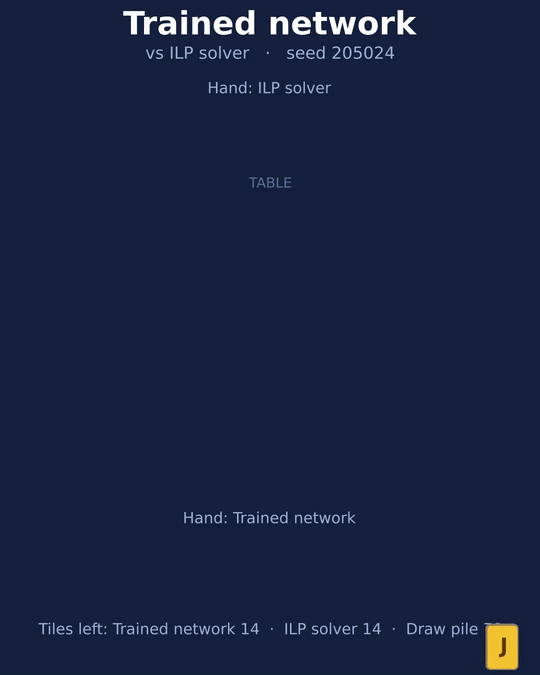

# Rummikub: which strategy wins, and why?

A from-scratch Rummikub simulator (official rules: 106 tiles, two jokers, 14-tile hands, 30-point opening meld, several melds per turn, extending melds, table rearrangement) and a simulation study of heuristics, reinforcement learning, search and an LLM decision-maker.

The paper is in [`artigo/main.pdf`](artigo/main.pdf) (LaTeX source in [`artigo/main.tex`](artigo/main.tex)).

<p align="center">
  <br>
  <sub>A small policy network, from random play to its trained form (full video: <a href="docs/evolucao.mp4">docs/evolucao.mp4</a>).
  The network only relearned "play as many tiles as possible"; it did not discover anything new.</sub>
</p>

<p align="center">
  <br>
  <sub>A network trained on larger tables beats an external, third-party ILP solver
  (<a href="https://github.com/mjpieters/rummikub-solver">mjpieters/rummikub-solver</a>) wrapped as a greedy player
  (full video: <a href="docs/rede_vs_solver.mp4">docs/rede_vs_solver.mp4</a>).</sub>
</p>

## Findings

All results are conditional on this simulator and this strategy menu; "best" means best in this benchmark, not optimal Rummikub play.

- **Winner by games won: the joker-saver** (plays as many tiles as possible, but spends a joker only if the move empties the hand). Mean score 0.726 ± 0.027 against the field in a paired round-robin of seven strategies; max-tiles scores 0.676.
- **Why:** it wins by holding a wildcard until it can go out (71% of its wins end with a joker, against 4% for the control). Four ablations isolate this: a soft joker penalty does not reproduce the effect, forbidding joker removal from the table does not remove it, and forbidding the joker even as the final tile destroys the advantage.
- **But the official metric inverts the ranking.** Rummikub scores tile points, zero-sum, with a joker left in hand counting 30. Scored both ways on the same 18,000 games, the joker-saver is first in games won and sixth of ten in points, 5.6 [3.8, 7.4] below max-tiles, because it ends its losses holding 0.80 jokers. Holding a wildcard is a bet that pays a win and charges 30 points when it fails.
- **Over sessions, the inversion is complete.** Played as the rules define — ten hands, points accumulated, 3,600 sessions — the joker-saver wins the most hands of any strategy (5.4 of 10) and the fewest sessions (0.288 ± 0.030), losing 72.5% of sessions to max-tiles. The session ranking is the exact reverse of the per-hand win ranking (Spearman −1.00), and the effect grows with session length. A 0.573 per-hand win rate — the kind of margin this literature reports as an improvement — meant losing three sessions out of four.
- **Robustness:** the game-count ranking survives the official pool-exhaustion tie-break, a larger rearrangement-search cap and a 12-strategy league. At three and four players the saver's edge over max-tiles shrinks and then vanishes.
- **Learning does not beat it, under either metric:** a tabular strategy selector, the Jev System One model as selector or move chooser, determinised Monte Carlo search, and a small policy network trained by REINFORCE all fail to beat the best heuristics. Cloning the saver and refining with group-relative advantages reaches parity (at best 0.550 ± 0.040 against max-tiles and 0.495 ± 0.040 against the saver, exploratory). Reward shaping, a wider league, a residual network over the saver and a search that sees hidden hands add nothing. Rewarding the official score instead of games won makes the network release jokers earlier, as the heuristics say it should, and still leaves it 5.1 points below max-tiles in points — so the negative result is not an artefact of the reward.

Negative results are reported as found; see the paper's Limitations section for what was not tested.

## Layout

| Path | Contents |
|---|---|
| `src/jogo/` | rules engine (tiles, melds, turns, table rearrangement) |
| `src/estrategias/` | strategies, policy network (numpy), cloning, PIMC search, Jev agents, tournament arena |
| `src/humano/` | browser table to play against the strategies yourself (stdlib HTTP server + one HTML file) |
| `src/experimentos.py` | command-line entry point for every experiment (`torneio`, `liga`, `pontos`, `sessao`, `mecanismo`, `limites`, `mesa`, `busca`, `rede`, `clonar`, `jev`, `robustez`, ...) |
| `src/analise*.py` | tables and figures for the paper |
| `src/animacao/` | Manim animations of games and of the learning run |
| `tests/` | unit and end-to-end tests |
| `resultados/` | per-game JSONL records and training logs behind every table (no API keys) |
| `artigo/` | paper: LaTeX source, tables, figures, PDF |

Identifiers and CLI flags are in Portuguese.

## Running

Developed on Python 3.14. The core depends on `pydantic` and `numpy` (the policy network).

The external-opponent experiment (`solver_ilp`) uses the third-party, MIT-licensed
[rummikub-solver](https://github.com/mjpieters/rummikub-solver) in a separate virtual
environment (`python -m venv .venv-solver && .venv-solver/bin/pip install rummikub-solver`);
it is optional and never imported by the core.

```bash
python -m venv .venv && .venv/bin/pip install -r requirements.txt
.venv/bin/python -m unittest discover -s tests          # full test suite

# paired tournament of the seven strategies
.venv/bin/python -m src.experimentos torneio --help

# train the policy network (REINFORCE; also --algoritmo dmc | ppo)
.venv/bin/python -m src.experimentos rede --iteracoes 300 --jogos 24 --processos 4 --saida resultados/minha_rede

# play against a strategy yourself, in the browser
.venv/bin/python -m src.humano                      # joker-saver, the strongest
.venv/bin/python -m src.humano --oponente cauteloso  # the weakest, to warm up
```

### Playing against the strategies

`python -m src.humano` opens a table at `http://127.0.0.1:8000/`. Drag tiles
freely: between your hand and the table, between melds, and within either one to
reorder (tiles insert where you drop them, not at the end). Shift-click selects
several tiles to move together. **Jogar** (Enter) commits the whole table at
once, **Desfazer** (Esc) reverts the turn, and Space sorts your hand. The table
shown is a draft: nothing reaches the engine until you commit, and the engine
validates it with the same rules the agents play under, so an illegal table is
refused with the engine's own message. The browser re-checks melds only to grey
out the button early; `tests/test_humano_frontend.py` cross-checks that copy
against the engine on 3,299 cases so the two cannot drift apart.

The agents' turns are replayed tile by tile, with a pause before the move and
between tiles, so you can see where each one went instead of the table jumping
to its final state. Your hand keeps the order you put it in: drawing a tile
appends it at the end rather than reshuffling the rack, and melds are tidied
into reading order (runs ascending, groups by colour) once the turn closes. The
move log numbers every move with a timestamp, most recent first, and the header
shows a clock for the current game. There is no hint button: the engine can
compute what the joker-saver would play, but the server does not expose it,
because handing you the opponent's move defeats the point of playing against it.

The opponent list includes `points-net`, the network from the scaling
experiment (`resultados/plano15/`): 192,000 training games with the official
score as reward. It wins fewer hands than the joker-saver (0.39 against it) and
still comes out ahead on points, because it dumps the joker and empties its
hand before losing instead of chasing the win. It is the only learned agent here
with a positive interval against the joker-saver in points.

The server listens on localhost only and has no authentication, because it
serves a single-player game on your own machine; do not expose the port. Each
finished game appends one line to `resultados/humano.jsonl` (`--sem-registro`
turns it off). Those games are **not** evidence for the paper: the human knows
the strategies under test, which is exactly the bias the paper's protocol avoids
by pairing seeds between agents.

Tables and figures need `matplotlib` and `numpy` (`pip install -r requirements-analise.txt`), then `python -m src.analise`.
The animations need Manim and ffmpeg and are not part of the core.

The Jev experiments call a paid external API and need `TYPESAFE_API_KEY` in the environment (or in a `.env` file passed with `--env`). Everything else runs offline. Cached results for the Jev runs are in `resultados/`.

## Reproducibility notes

- Evaluations are paired (same deal, seats alternated) with separate seed ranges per experiment; confidence intervals are over games.
- Experiments are labelled exploratory or confirmatory in the paper; only the sustained claims are in the abstract.

## Author

Marcos de Pinho Tavares Proença.
